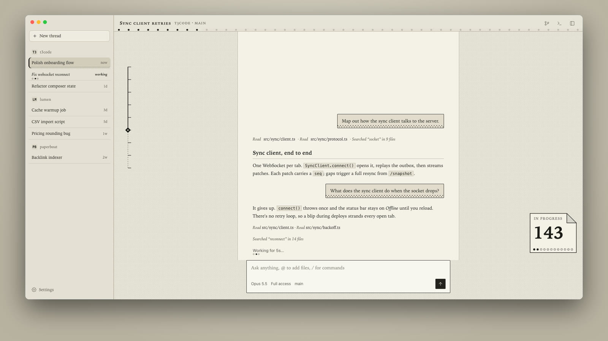

# Folio

**A reading theme for [T3 Code](https://t3.codes).** Warm paper, ink-black serif type, almost no colour. While your agent works, a row of dots fills across the header. When the turn ends, the page turns once (a short stepped grey flash) and goes still.

**[See it in motion →](https://joshsaintjacque.github.io/t3code-theme-folio/)**



## Install

**From the app**

1. Download [`folio.json`](folio.json), or copy its contents.
2. In T3 Code, open **Settings › Appearance › Add theme**.
3. Choose the file, or paste the JSON, and add it.

**From the terminal**

```sh
curl -fsSL -o folio.json https://joshsaintjacque.github.io/t3code-theme-folio/folio.json
~/.t3/bin/t3 theme set folio.json
```

`t3 theme set` publishes the file and sets it as the environment theme, so every client connected to that environment switches to it.

Tested on T3 Code v0.1.11 (nightly).

## What moves, and when

Everything moves in whole steps, like a paper display redrawing, and only when the app is doing something.

| | |
|---|---|
| **Dot progress** | 48 dots along the foot of the header fill one at a time while a turn runs, up to just short of the end. Then the leading dots keep stepping until the turn is done; the bar never claims to be finished and long turns never restart it. |
| **Page refresh** | When a turn ends the desk steps to mid grey and back (0.5s, 8 steps). Never on app launch, thread switch or turn start. |
| **Ruler marker** | On wide windows the left margin is a ruler. During a turn the marker steps down it, three ticks over 24s. |
| **Folio card** | In the right margin a page-number card counts up and fills its own dots while the turn runs. |
| **Three dots** | Busy threads and the live *Working…* row show three hollow dots with one filled, stepping. |
| **Hover and focus** | A thread row grows an ink rule; the composer border becomes a true double rule on focus. |
| **Narrow windows** | No margin to spare? The folio card docks at the foot of the sidebar. |

`prefers-reduced-motion` turns all of it off and leaves the finished page.

## Palette

| Role | Hex |
|---|---|
| Canvas | `#E9E5DA` |
| Sidebar | `#E5E0D4` |
| Message | `#E2DCCD` |
| Code | `#E8E3D6` |
| Text | `#1C1B18` |
| Muted | `#55514A` |
| Accent | `#24221E` |
| Error | `#8C2F25` |
| Warning | `#7D5B14` |
| Update | `#35495C` |

## Make your own variant

`folio.json` is generated. Edit [`source/build.py`](source/build.py) and run it:

```sh
python3 source/build.py       # writes folio.json and assets/svg/
python3 source/build_site.py  # regenerates index.html from the palette
```

---

A community theme, not affiliated with or endorsed by T3 Code. [MIT licensed](LICENSE).
